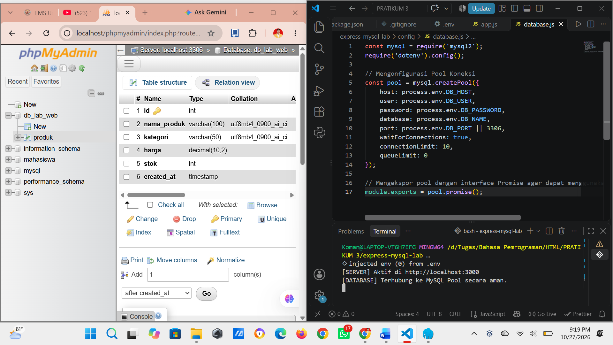
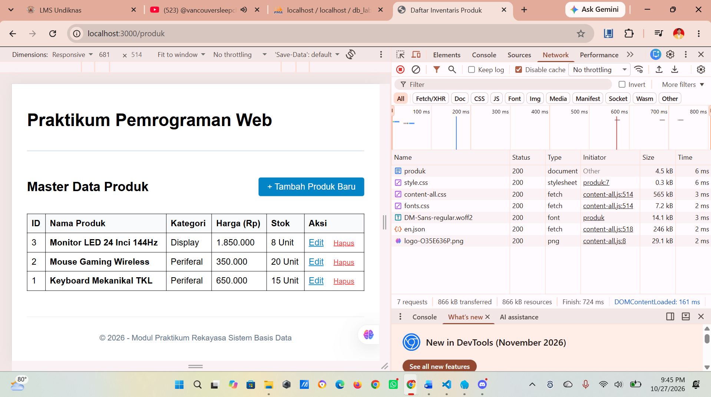
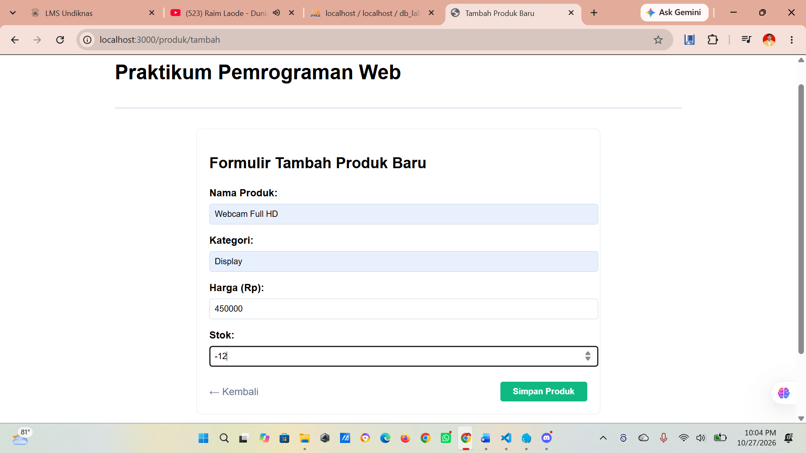
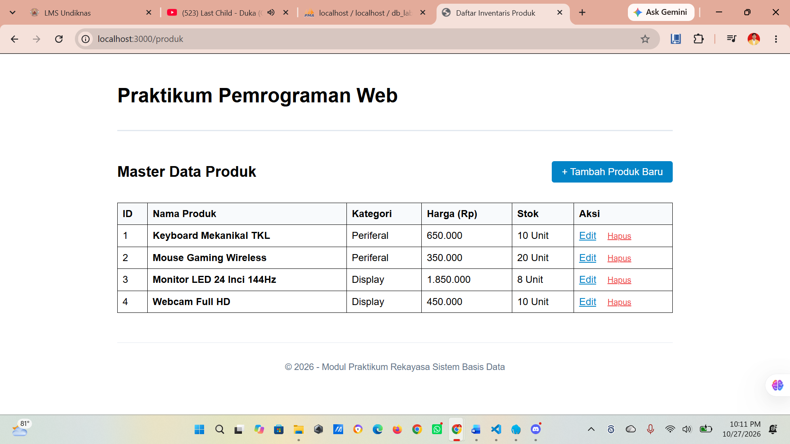
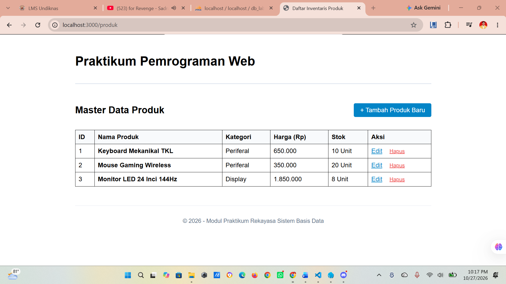
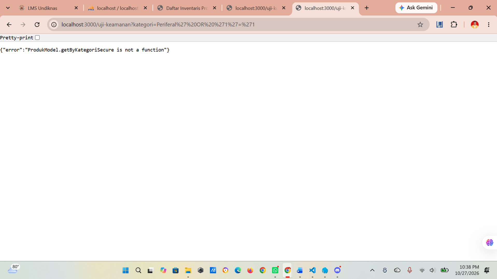
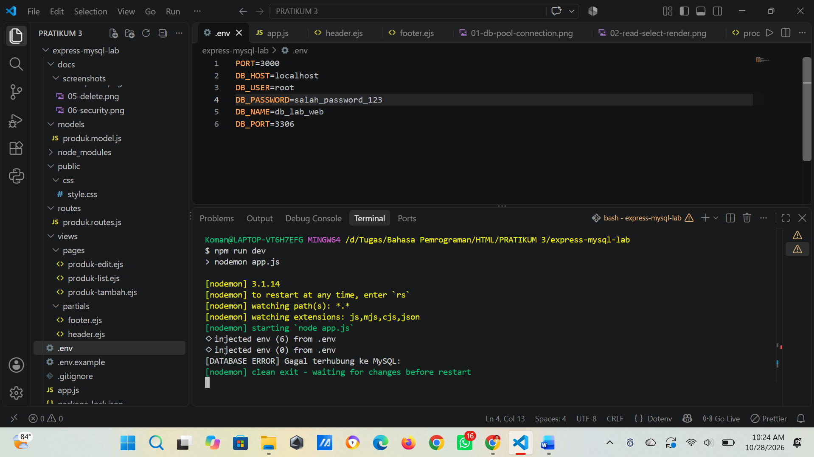
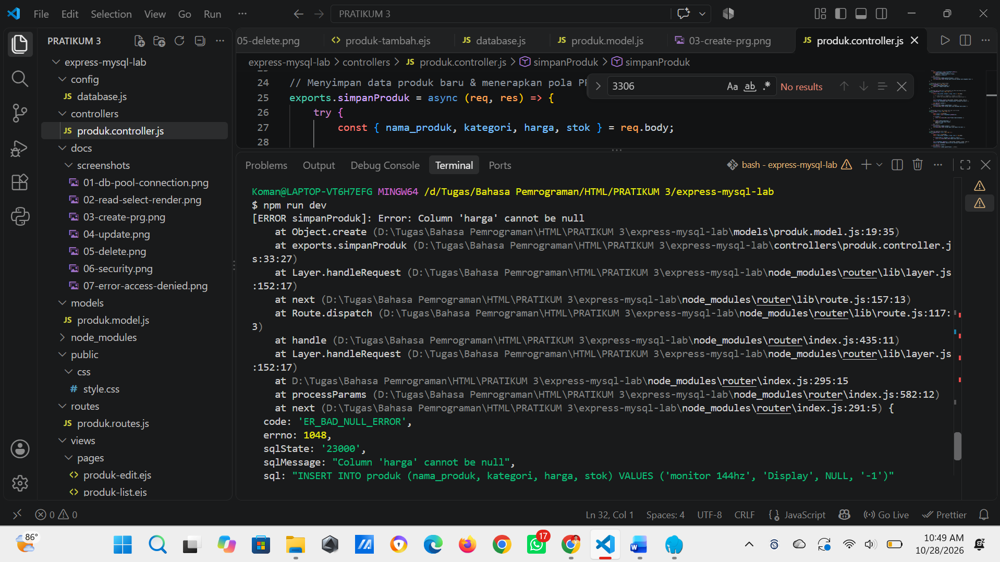
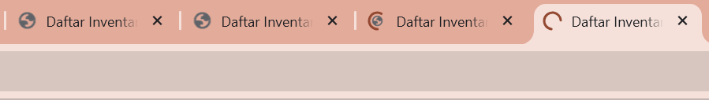

# Modul Praktikum 3 - Rekayasa Sistem Basis Data: Persistensi MySQL, Connection Pooling, & Prepared Statements

Repositori ini berisi rangkaian praktikum terbimbing, pengujian keamanan, serta penanganan investigasi masalah (*troubleshooting*) menggunakan Node.js, Express, MySQL2, dan EJS.

## Traceability Matrix & Logbook Pengujian Praktikum

| ID Uji | Fitur / Operasi | Target Endpoint URL | HTTP Method | Skenario Pengujian | Hasil yang Diharapkan | Status | Bukti Tangkapan Layar |
| :--- | :--- | :--- | :--- | :--- | :--- | :--- | :--- |
| **TC-01** | Koneksi Pool | App Startup | - | Server dijalankan pertama kali | Terhubung ke MySQL Pool tanpa error[cite: 17] | Pass |  |
| **TC-02** | Read (All) | `/produk` | GET | Akses halaman daftar produk | Menampilkan seluruh record tabel MySQL ke antarmuka EJS | Pass |  |
| **TC-03** | Create | `/produk/tambah` | POST | Submit formulir produk baru | Data tersimpan di DB, Dev Tools mencatat 302 Redirect | Pass |  |
| **TC-04** | Update | `/produk/edit/:id` | POST | Mengubah harga & stok produk | Nilai kolom pada baris MySQL berubah sesuai input baru | Pass |  |
| **TC-05** | Delete | `/produk/hapus/:id` | POST | Eksekusi tombol hapus produk | Baris record terhapus dari MySQL dan UI ter-refresh | Pass |  |
| **TC-06** | Keamanan | `/uji-keamanan` | GET | Input payload uji keamanan via URL | Prepared Statement memperlakukan input sebagai literal string | Pass |  |
| **TC-07** | Troubleshooting | App Startup | - | Mengubah sandi database menjadi salah | Memunculkan galat `ER_ACCESS_DENIED_ERROR` | Pass |  |
| **TC-08** | Troubleshooting | `/produk/tambah` | POST | Mengubah atribut nama input form HTML | Memunculkan galat `Bind parameters must not contain undefined` | Pass |  |
| **TC-09** | Troubleshooting | Load Testing | - | Menguji batas kapasitas connection pool | Mendeteksi atau menangani antrean/exhaustion pool | Pass |  |

## Cara Instalasi & Menjalankan Proyek
1. Clone repositori ini ke komputer lokal.
2. Jalankan perintah `npm install` untuk mengunduh seluruh dependensi (`express`, `ejs`, `mysql2`, `dotenv`)[cite: 26].
3. Buat file `.env` berdasarkan contoh file `.env.example` dan sesuaikan konfigurasi database lokal Anda.
4. Jalankan server mode pengembangan dengan perintah:
   ```bash
   npm run dev